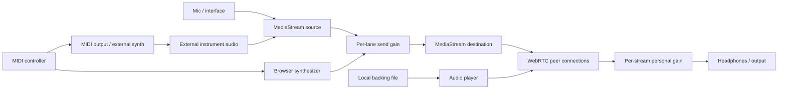

# Architecture

## Source layout

```text
server.mjs            HTTP/HTTPS, WebSocket signaling, room state
public/index.html     Responsive room interface
public/styles.css     Application styles
public/app.js         Browser audio, MIDI, room state, and controls
public/metronome.js   Audio-clock click scheduler and shared timing controls
public/diagnostics.js Read-only live connection report
scripts/check-setup.mjs Local and remote configuration preflight
test/                 Room, persistence, timing, and MD checks
.env.example          Configuration template
package-lock.json     Locked runtime dependency
```

The only runtime package is `ws`. Node serves a fixed public-file allowlist. Application source, environment files, keys, and documentation are not accessible through the web server.

## Audio flow



Microphone/interface input is captured without browser echo cancellation, noise suppression, or automatic gain. It feeds an independent gain node and stream destination for every channel. Microphone sources are not locally monitored. MIDI is synthesized through Web Audio and monitored locally as well as sent. Backing audio is routed through a media-element source to both local playback and a stream destination.

Each participant has a peer connection to every other participant. Separate audio streams preserve instrument identity and independent receiver gains. The server only relays room events and SDP/ICE messages; it does not mix or record media. Direct WebRTC or a TURN relay carries media. Increasing participants multiplies peer connections and outgoing bandwidth.

## State and lifecycle

Persistent server data includes browser-ID room roles, shared setlists, chat/session history, and shared metronome settings. `ROOMTONE_DATA` selects the JSON store. Active peers, stream labels, clock reports, and WebRTC signaling are in memory. Late joiners receive the roster, recent history, shared setlist, active labels, room role, and active metronome state. Signaling is routed only inside the sender's room.

The client serializes signaling operations per peer and uses polite/impolite offer collision handling. Microphone tracks, gain nodes, MIDI listeners, and outgoing streams are disconnected when removed or when leaving. The AudioContext is retained across room joins so backing-track routing remains valid.

MD talkback uses a separate gain gate. Its effective gain is zero unless the button is held and the lane is unmuted. Fader changes cannot open an idle MD channel. Pointer release, keyboard release, blur, and tab hiding close it.

## Access and limits

No account or sign-in is required. Each browser generates a local random ID to remember its display name and room role. Anyone who knows a room code can join. The first browser to join a room becomes its owner and can assign the MD role to another browser. Owner/MD can start, stop, and change shared tempo; members can mute their own shared click or start a local click when shared timing is stopped. Room members can edit the shared setlist. Roles are convenience controls, not a security boundary, because room identity is intentionally lightweight. Rooms are limited to eight participants by default. Browser/network testing is needed to establish a useful maximum for deployment.

The server checks HTTP API and WebSocket Origin/Host consistency (or configured PUBLIC_ORIGIN), limits messages to 128 KiB, rate-limits messages per connection, and uses the maintained `ws` implementation for framing and heartbeat. These measures do not make the app a complete public multi-tenant service. The ICE configuration endpoint is public; use suitable relay credentials.

## Timing

Each browser estimates server clock offset from WebSocket request/response samples. The room owner or MD sends a start/tempo command with a future server timestamp. Clients convert the shared downbeat and count-in to their AudioContext clock and schedule clicks ahead using a short look-ahead timer. Tempo changes broadcast a new effective timestamp: the old click continues until the transition, then the new tempo begins at beat one. Recent clock samples are refreshed continuously; the lowest-RTT subset estimates offset. Scheduling uses the current server-clock estimate on each tick and skips missed beats while retaining phase after background throttling. Clock RTT and drift estimates are reported by each browser and shown to all room members. Click audio is never attached to outgoing room streams. Browser background throttling, audio device latency, and WebRTC playout are not controlled by this clock protocol.

The sync panel reports clock-probe RTT and estimated clock drift; the room mixer also reports selected ICE candidate-pair RTT. These values are not end-to-end microphone-to-headphone delay or proof of acoustic beat alignment. Browser buffering, device latency, encoding, network path, and playout buffering add delay. Actual delay/drift validation still requires two or more real clients on separate networks and, for acoustic latency, a loopback/microphone measurement. The backing track is streamed from one browser; receivers do not have a synchronized local copy.

Setlists use a stored revision for conflict detection. Persistence replaces the JSON file through a temporary file; malformed existing JSON aborts startup. The shared transport is stopped after a server restart or the last participant leaving. A failed ICE path triggers up to three restart attempts; loss of signaling requires a manual rejoin and explicit source reconnection. Input-selection cancellation and late permission results are handled without publishing sources into a closed room. MIDI device disconnects remove the affected source and external MIDI cleanup sends sustain-off/all-notes-off.
